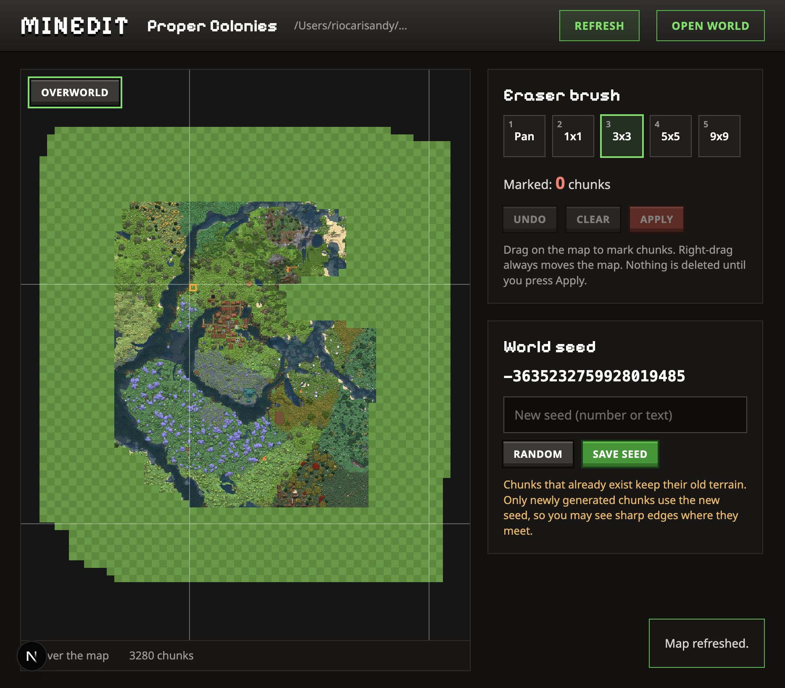
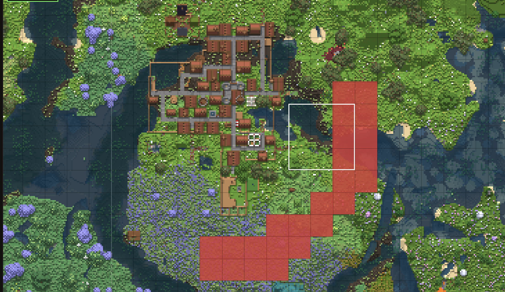
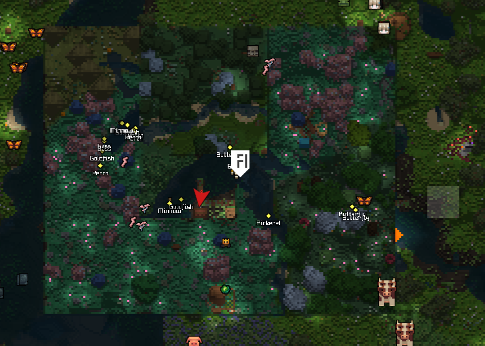

# minedit

Erase chunks and change the seed of a Minecraft **Java** world, from a browser map with 1:1 **Xaero's World Map** rendering.



## Why minedit?

I love exploring in Minecraft and keeping a permanent home base, while playing on a modest ("potato") laptop. Over time, normal survival worlds accumulate abandoned structures (like cleared boss dungeons) and grow huge on disk. `minedit` was built to give you full control: keep your base intact, erase only the chunks you want to reset, and optionally switch the seed for a fresh adventure.

### How it compares

| Mode / Approach | Trade-off |
| --- | --- |
| **Chunk by Chunk** | Requires grinding thousands of stone for a world core spawn, often with underwhelming results. |
| **Skyblock** | Focuses on expanding a base rather than world exploration. |
| **Island in a Jar** | One-shot minigame experience. |
| **Normal Survival** | Leaves abandoned buildings behind and bloats world size over time. |
| **Online Multiplayer** | Often enforces an uneditable/claimed base with a war zone outside. |

### Vision

Looking ahead, `minedit` enables an inverted approach: your **base stays editable**, while the outer adventure world behaves like an **RPG dungeon**—areas that can be reset and regenerated cleanly once conquered, instead of permanently cluttering or bloating your save.

## Features

- **3-Tier Map Rendering:**
  1. **Tier 1 — Xaero's World Map:** Automatically detects Xaero World Map caches (`cache_1/*.xwmc` at 512×512 block resolution or legacy `.pwm`) in your Minecraft / CurseForge instance and renders them 1:1.
  2. **Tier 2 — MCA Heightmap & Hillshading:** Falls back to chunk `Heightmaps` (`WORLD_SURFACE` / `MOTION_BLOCKING`) with slope shading when Xaero cache is unavailable.
  3. **Tier 3 — Chunk Presence:** Renders a green checkerboard for existing `.mca` chunks that have not yet been cached by Xaero (such as Minecraft's outer generation buffer ring).
- **Deleted Chunk Masking & Refresh:** Chunks deleted from `.mca` are immediately masked out on the map. Use the **Refresh** button in the top bar to reload disk changes without resetting your current zoom or pan position.
- **Eraser Brush & Seed Editor:** Mark chunks with adjustable brush sizes (`1`–`5`), undo strokes (`Ctrl/Cmd+Z`), and update the world seed in `level.dat`.

## Run

```sh
bun install
bun run dev     # starts http://localhost:3000
```

Or run a production build:

```sh
bun install
bun run build
bun run start   # starts http://localhost:3000
```

Open `http://localhost:3000` in your browser, press **Open world** (or **Open world folder**), and pick a folder marked `WORLD` (the folder containing `level.dat` — for CurseForge instances, look under `Documents/curseforge/minecraft/Instances/<Instance>/saves/<World>`).

### Controls

- **Left-drag:** Mark chunks red for deletion (pick brush sizes with keys `1`–`5`, where `1` is Pan).
- **Right-drag / Scroll:** Move the map / zoom in and out.
- **`Ctrl/Cmd+Z`:** Undo the last stroke.
- **Apply:** Erase marked chunks from `region/`, `entities/`, and `poi/` `.mca` files.
- **Refresh:** Re-scan `.mca` chunks and Xaero tiles from disk while keeping your camera view.
- **World seed:** View or update the world seed (numbers are stored as-is; text is hashed like Minecraft Java).

## Examples

### 1. Marking Chunks for Deletion

Pick a brush size (`2`–`5`) and drag across the map to highlight target chunks in red. Thanks to 1:1 Xaero's World Map rendering, you can accurately paint around builds or colonies before pressing **Apply**.



### 2. Regenerating Terrain with a New Seed

After deleting the selected chunks and updating the **World seed**, Minecraft regenerates those chunks using the new seed the next time you load the area—producing new biomes and terrain along sharp chunk borders where they meet the existing world.



## Safety

- **Close Minecraft before applying anything.**
- Every change copies the touched files to `<world>/.minedit-backup/<time>/` first. To undo, copy them back.
- A deleted chunk is regenerated by the game the next time it loads. A new seed only affects chunks generated after the change, so old and new terrain can meet with a sharp edge.
- Runs locally on your machine to edit your local world saves.

## Develop

```sh
bun run dev     # http://localhost:3000
bun test        # run unit & API tests
bun run build   # production build & typecheck
```
